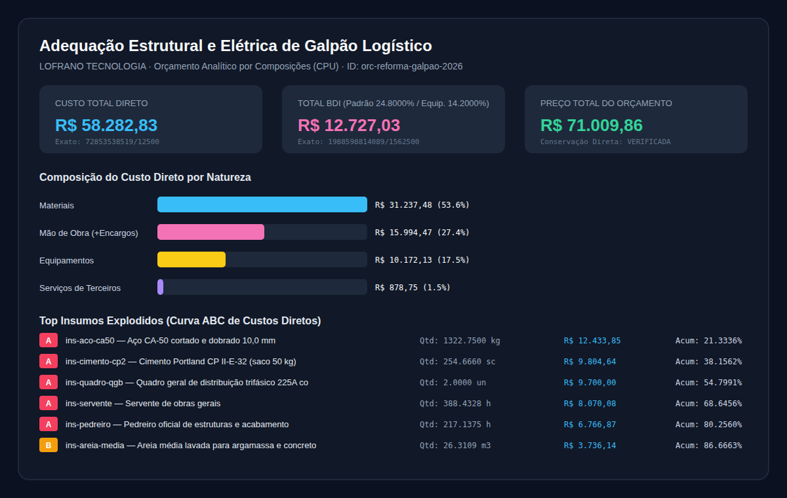

# Orçamento por Composições

Calcule orçamentos analíticos por composições de preços unitários (CPU), decomponha custos diretos por natureza, aplique encargos sociais e BDI (padrão, diferenciado para equipamentos ou isento) e gere a explosão global de insumos com classificação ABC de Pareto.

CLI e biblioteca Python da [LOFRANO TECNOLOGIA](https://lofranotecnologia.com.br/), em português, sob [licença MIT](LICENSE). Todos os coeficientes, perdas, encargos e preços intermediários usam aritmética racional exata (`Fraction`); a execução ocorre localmente, sem rede, banco externo ou dependências de terceiros.



## Experimentar

Requer Python 3.11 ou posterior:

```sh
git clone https://github.com/martinlofranodeoliveira/orcamento-composicoes.git
cd orcamento-composicoes
python3 -m venv .venv
.venv/bin/python -m pip install .
.venv/bin/orcamento-composicoes exemplo --saida exemplo-orcamento.zip
```

No Windows:

```powershell
python -m venv .venv
.venv\Scripts\python -m pip install .
.venv\Scripts\orcamento-composicoes exemplo --saida exemplo-orcamento.zip
```

Descompacte `exemplo-orcamento.zip` e consulte `RELATORIO.md`, `painel-orcamento.svg`, `itens-orcamento.csv`, `insumos-abc.csv` e `orcamento-analitico.json`. O exemplo autoral simula a adequação estrutural e elétrica de um galpão logístico com 12 insumos no catálogo (11 utilizados e 1 item reserva sem demanda), 5 composições (incluindo composições auxiliares aninhadas em DAG para argamassa e concreto) e 4 itens de orçamento exercitando os três modos de BDI (`padrao`, `diferenciado_equipamentos` e `isento`).

## Calcular seus arquivos

```sh
orcamento-composicoes calcular meu-orcamento.json --saida resultado-orcamento.zip
```

O pacote ZIP gerado nunca sobrescreve um caminho existente: a publicação cria um arquivo temporário irmão e usa `os.link` exclusivo. O arquivo contém:

| Arquivo no ZIP | Finalidade |
| --- | --- |
| `entrada.json` | Bytes originais exatos submetidos ao cálculo |
| `orcamento-analitico.json` | Memória de cálculo completa com frações exatas (`numerador`/`denominador`), composições, itens e explosão ABC |
| `itens-orcamento.csv` | Planilha de itens com custo unitário, custo total direto, BDI, preço total e participação |
| `insumos-abc.csv` | Explosão global consolidada de insumos em ordem decrescente de custo direto (classes A, B e C) |
| `RELATORIO.md` | Relatório legível em português para revisão humana |
| `painel-orcamento.svg` | Gráfico vetorial de síntese financeira, distribuição por natureza e curva ABC |
| `LEIA-ME.md` | Guia rápido do pacote gerado |
| `SHA256SUMS` | Hashes SHA-256 de todos os arquivos do pacote |

## Precisão, conservação e limites

- **Aritmética racional exata**: cada insumo tem preço unitário base em centavos inteiros; encargos sociais (aplicáveis exclusivamente à mão de obra), coeficientes de consumo, percentuais de perda e taxas de BDI são avaliados como frações exatas (`fractions.Fraction`).
- **Teorema da conservação direta**: a soma dos custos diretos de todos os itens da planilha orçamentária coincide exatamente (em numerador e denominador) com a soma dos custos diretos da explosão global de insumos elementares (`custo_total_direto == custo_explosao_insumos`).
- **Grafo acíclico de composições (DAG)**: composições principais podem referenciar composições auxiliares em múltiplos níveis; qualquer referência circular é detectada deterministicamente e recusada com código `CICLO_COMPOSICAO` e o caminho fechado do ciclo.
- **Limites explícitos**: até 2.000 insumos, 1.000 composições, 200 componentes por composição, 1.000 itens de orçamento e 8 MiB de entrada UTF-8 sem BOM. Floats JSON, `NaN`, `Infinity`, chaves duplicadas e campos desconhecidos são recusados antes do cálculo.

Consulte o esquema completo em [docs/FORMATO.md](docs/FORMATO.md), a interface Python em [docs/API.md](docs/API.md), os procedimentos de auditoria em [docs/VERIFICACAO.md](docs/VERIFICACAO.md) e o oráculo independente em [docs/INTEROPERABILIDADE.md](docs/INTEROPERABILIDADE.md).

## Desenvolver e verificar

```sh
python3 -m pip install . -r requirements-build.txt
python3 -m unittest discover -s tests -v
python3 -m build
python3 scripts/check_distribution.py --dist dist
python3 tools/verify_independent.py
```

Licença [MIT](LICENSE) · **LOFRANO TECNOLOGIA**.
